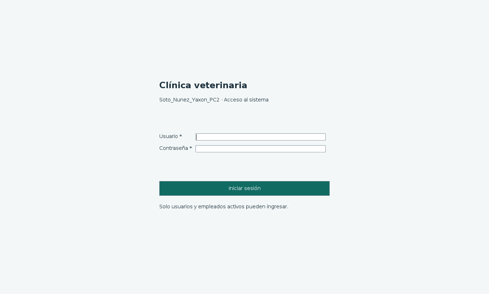
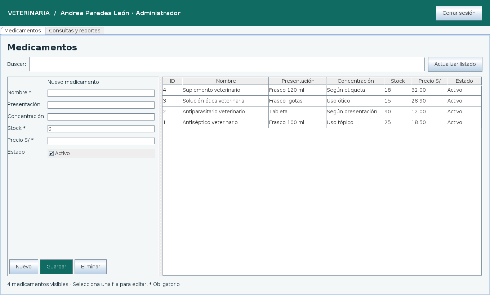
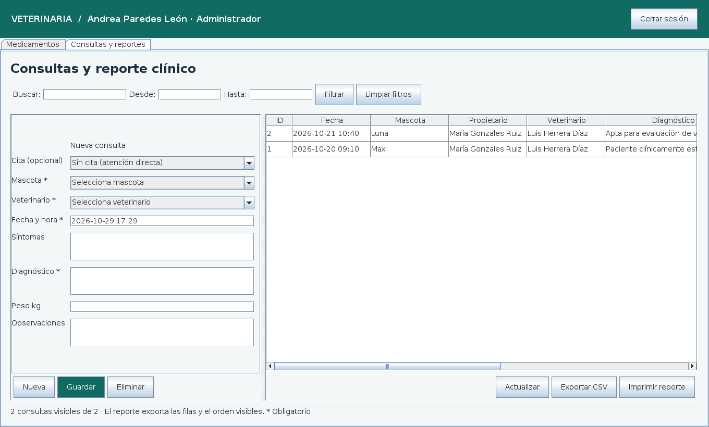

# Soto_Nunez_Yaxon_PC2

Aplicación de escritorio para la **Práctica Calificada N.º 2 — Taller de Programación II, 2026-II**. Java Swing + Maven + MySQL, usando el SQL Veterinaria proporcionado.

[Descargar proyecto completo + JAR (ZIP)](https://github.com/grabielsotonunez-collab/Soto_Nunez_Yaxon_PC2/raw/refs/heads/main/dist/Soto_Nunez_Yaxon_PC2.zip)

## Funciones

- Inicio de sesión contra `usuario`, comprobación del hash SHA-256 de los datos demo, estado de cuenta y empleado activo; actualización del último acceso y cierre de sesión.
- Medicamentos: crear, listar, buscar, seleccionar, actualizar y eliminar. Estado activo/inactivo, control de stock y precio.
- Consultas: atención directa o vinculada a una cita, mascota y veterinario, fecha/hora, síntomas, diagnóstico, peso y observaciones. Crear, modificar, eliminar y visualizar el historial con propietario y veterinario.
- Reporte: búsqueda por texto, rango de fechas inclusivo, orden por columnas, exportación CSV UTF-8 compatible con Excel e impresión mediante el diálogo del sistema (puedes elegir una impresora PDF).
- Operaciones JDBC en segundo plano para mantener la interfaz disponible; sentencias preparadas, conexiones cerradas y transacciones para consultas/citas.

## Estructura para NetBeans

```text
Soto_Nunez_Yaxon_PC2/
├── pom.xml
├── nbactions.xml
├── config/database.properties.example
├── database/veterinaria_mysql.sql
├── src/main/java/
│   ├── CONEXION/       CONEX.java
│   ├── Controlador/    Validacion, Tareas y ReporteCSV
│   ├── DAO/            UsuarioDAO, MedicamentoDAO y ConsultaDAO
│   ├── MODELO/         Usuario, Medicamento, Consulta y Opcion
│   └── com/mycompany/soto_nunez_yaxon_pc2/
│                       App y formularios Swing
├── src/test/java/pruebas/
└── docs/
```

Los formularios se construyen en Java con administradores de diseño; se editan en código. No requieren archivos `.form`, librerías visuales externas ni el complemento Anahata. Los paquetes siguen la estructura de la captura; el paquete principal corresponde al nuevo nombre del proyecto.

## 1. Requisitos

- JDK **17 o superior** (17 y 21 son adecuados), Maven 3.9+ o Maven integrado de NetBeans.
- MySQL **8.x** funcionando. En XAMPP verifica qué motor y versión incluye; las pruebas de este proyecto se hicieron sobre MySQL 8.4.
- Escritorio gráfico para ejecutar Swing. Internet para la primera descarga de dependencias Maven.

## 2. Base de datos

Importa `database/veterinaria_mysql.sql` con MySQL Workbench, phpMyAdmin o la consola:

```sh
mysql --default-character-set=utf8mb4 -h 127.0.0.1 -P 15327 -u YAXON -p < database/veterinaria_mysql.sql
```

**Atención:** el SQL original elimina y vuelve a crear sus tablas y datos demo. Haz una copia de seguridad si ya tienes datos. La aplicación no importa ni borra la base automáticamente. El SQL no crea usuarios MySQL: tu usuario `YAXON` debe existir y tener permisos sobre `veterinaria`.

## 3. Conexión conservada y adaptada

`CONEXION/CONEX.java` conserva `DriverManager`, el controlador `com.mysql.cj.jdbc.Driver`, host `127.0.0.1`, puerto `15327`, usuario `YAXON`, opciones y tiempos de espera de tu captura. La base cambia de `restaurante` a **`veterinaria`**.

Copia `config/database.properties.example` como **`config/database.properties`** y escribe allí tu misma clave MySQL en `clinica.clave`. Ese archivo está ignorado por Git y no se incluye en el ZIP; la contraseña privada no se publica. No confundas la clave de MySQL con la contraseña del usuario de la aplicación.

```properties
clinica.url=jdbc:mysql://127.0.0.1:15327/veterinaria?useSSL=false&connectionTimeZone=LOCAL&allowPublicKeyRetrieval=true&characterEncoding=UTF-8&connectTimeout=5000&socketTimeout=15000
clinica.usuario=YAXON
clinica.clave=ESCRIBE_AQUI_TU_CLAVE_MYSQL
```

Solo cambia el puerto si tu servidor usa otro; XAMPP suele utilizar 3306. No necesitas editar el código. Estas opciones conservan la configuración local de la captura; para conexiones remotas configura TLS verificado.

Se admiten las mismas propiedades `-Dclinica.url`, `-Dclinica.usuario`, `-Dclinica.clave`, o las variables `CLINICA_URL`, `CLINICA_USUARIO`, `CLINICA_CLAVE`. Prioridad: propiedades JVM → variables → archivo local → valores predeterminados. Para un archivo ubicado en otro directorio, usa `-Dclinica.config=/ruta/database.properties`. Evita poner claves en comandos o en Git.

## 4. Abrir y ejecutar

**NetBeans:** Archivo → Abrir proyecto → selecciona esta carpeta (la que contiene `pom.xml`). Selecciona un JDK 17+ en las propiedades, espera la descarga de Maven y ejecuta el proyecto con F6. La clase principal es `com.mycompany.soto_nunez_yaxon_pc2.App`.

**Consola**, desde la raíz del proyecto:

```sh
mvn clean verify
mvn exec:java
```

El ZIP incluye además **`Soto_Nunez_Yaxon_PC2.jar`**, con el controlador MySQL incorporado. Desde la carpeta descomprimida puedes usar `iniciar.bat` en Windows o `sh iniciar.sh` en Linux/macOS. Los lanzadores crean la plantilla de conexión si falta y piden completarla antes del primer inicio.

```sh
java -jar Soto_Nunez_Yaxon_PC2.jar
```

Si compilas desde GitHub, el JAR se genera en `target/Soto_Nunez_Yaxon_PC2.jar`.

### Usuarios de demostración incluidos en el SQL

| Usuario | Contraseña demo | Rol |
|---|---|---|
| admin | Admin123* | Administrador |
| vet01 | Vet123* | Veterinario |
| vet02 | Vet456* | Veterinario |
| recepcion | Recepcion123* | Recepción |
| vendedor | Venta123* | Vendedor |

El rol se muestra en la sesión; esta práctica permite los módulos a todos los usuarios habilitados. No implementa permisos diferenciados por rol. Los hashes SHA-256 se conservan para compatibilidad con el SQL académico; para producción corresponde migrar a Argon2/bcrypt.

## Validaciones y uso

- Campos obligatorios identificados con `*`; nombre y diagnóstico no pueden quedar vacíos ni contener solo espacios.
- Longitudes compatibles con la base: medicamento 100, presentación 80 y concentración 60 caracteres; textos clínicos limitados a 5000 caracteres.
- Stock entero de 0 a 2147483647. Precio de 0 a 99999999.99, con hasta dos decimales. Se permite punto o coma decimal, sin separadores de miles.
- Peso opcional, mayor que cero cuando se escribe y hasta 9999.99 kg. Fechas reales en `aaaa-MM-dd HH:mm`; filtros en `aaaa-MM-dd`, con Desde ≤ Hasta.
- Selecciona una fila para editar; **Nuevo/Nueva** limpia el editor. **Guardar** crea si no hay ID seleccionado y actualiza si se seleccionó un registro. Actualizar/Nueva descarta los cambios aún no guardados.
- La cita es opcional. Solo se ofrecen citas pendientes disponibles y la cita de la consulta editada. Al seleccionarla se asignan su mascota y veterinario. Deben coincidir al guardar; ambos deben estar activos y el empleado debe ser veterinario.
- Una cita admite una consulta. Guardar la marca Atendida. Si se libera la cita al eliminar o cambiar una consulta, vuelve a Confirmada; todos los cambios se confirman juntos o se deshacen juntos.
- Eliminar pide confirmación. Las claves foráneas impiden eliminar medicamentos recetados o consultas con recetas/tratamientos. No se borra el historial dependiente. Puedes desactivar un medicamento recetado en lugar de eliminarlo.
- **Filtrar** aplica las fechas y el texto; **Limpiar filtros** restablece el listado. CSV e impresión usan las filas y el orden visibles. Los valores que podrían interpretarse como fórmulas se exportan como texto.

## Pruebas

```sh
mvn test
```

Ejecuta 28 casos unitarios. Los 4 casos de integración requieren **una instancia MySQL desechable**, importada con el SQL, y se habilitan explícitamente:

```sh
# Exporta CLINICA_URL, CLINICA_USUARIO y CLINICA_CLAVE para ESA instancia.
PC2_MYSQL_TEST=true mvn verify
```

No ejecutes las pruebas de integración sobre tu base de trabajo: crean registros de prueba, actualizan estados demo temporalmente y prueban eliminaciones. En Windows PowerShell usa `$env:PC2_MYSQL_TEST='true'`. La prueba visual `pruebas.InterfazSmoke` se ejecuta por separado con escritorio o Xvfb; véase [validación](docs/VALIDACION.md).

## Capturas reales




